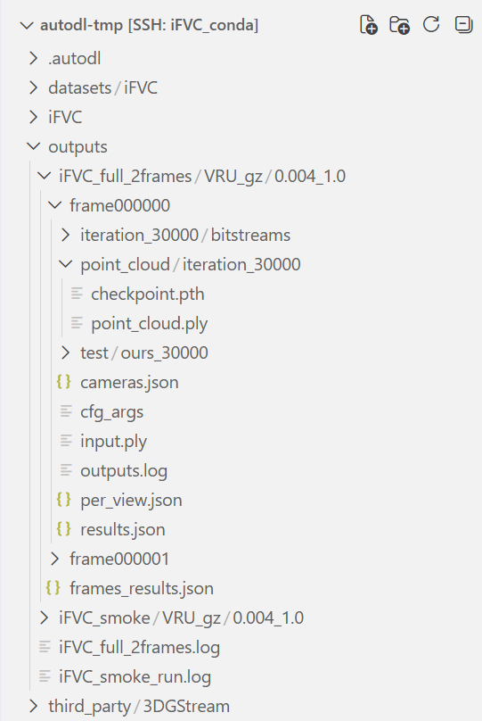

# iFVC 复现记录

> 本文档随复现实验同步更新。只有经过实际执行并确认成功的操作，才会进入正式步骤；尚未验证的内容统一标为“待验证”。

## 1. 复现目标

本次工作需要从干净的服务器环境出发，完成 iFVC 的环境配置、数据准备、I 帧训练、P 帧训练、编码、解码、渲染和指标汇总。最终文档应使读者无需询问作者即可复现实验，并在另一台服务器上按照同一套步骤完成复验。

本项目没有需要下载的 iFVC 预训练 checkpoint。第 0 帧模型由数据现场训练产生，后续 P 帧依赖上一帧的解码模型。LPIPS 评测所需的网络参数属于指标依赖，将在评测部分单独说明，不作为 iFVC 模型权重介绍。

### 1.1 文档使用约定

本文面向第一次接触 iFVC 的读者。除明确标有“按实际修改”的变量外，已验证步骤应当可以按代码块从上到下复制执行。完成第 4 节的环境创建后，后续涉及 Python、Pip、编译和实验运行的命令都默认已经激活 `(iFVC)` Conda 环境；如果打开了新的终端，需要先执行 `conda activate iFVC`。

项目目录、CUDA Toolkit、数据集、配置文件和实验输出目录会随服务器变化，不能藏在代码默认值或读者的当前工作目录中。本文采用以下规则：

- 第一次用到某类路径时，先定义含义明确的环境变量，再检查目标确实存在；
- 本次服务器的真实值作为可运行示例，并在变量行标注 `按实际修改`；
- 后续命令只引用变量，不在多处重复写死绝对路径；
- 如果原项目存在硬编码路径或隐式下载，先改成命令行参数、配置项或环境变量，再把验证后的调用方式写入本文；
- 每个需要编译的组件都说明源码从哪里取得、源码位于哪里、产物安装到哪里，以及什么情况下需要重新编译。

例如，本次服务器的项目路径写作：

```bash
export IFVC_ROOT=/root/autodl-tmp/iFVC  # 按实际修改：替换为自己的 Clone 目录
test -d "$IFVC_ROOT/.git"
cd "$IFVC_ROOT"
```

注释不会影响命令执行；如果 Clone 目录相同，这三行可以直接复制。如果目录不同，只改第一行即可。

## 2. 当前复现基线

### 2.1 这一步要回答什么问题

服务器是否具备复现官方环境、编译 CUDA 扩展和运行完整训练链路的基础条件？

### 2.2 已验证的服务器配置

检查日期：2026-10-14。

| 项目 | 实际结果 |
| --- | --- |
| 操作系统 | Ubuntu 20.04.4 LTS |
| GPU | NVIDIA GeForce RTX 4090，24 GB |
| NVIDIA 驱动 | 550.100 |
| `nvidia-smi` 显示的最高 CUDA 兼容版本 | 12.4 |
| CUDA 编译器 | CUDA 11.6，`nvcc 11.6.124` |
| GCC | 9.4.0 |
| Conda | 4.10.3 |
| 系统盘 | 30 GB，检查时剩余约 29 GB |
| 数据盘 | 50 GB，挂载于 `/root/autodl-tmp` |

需要区分 `nvidia-smi` 与 `nvcc` 的输出：前者显示驱动能够兼容的最高 CUDA 版本，后者才是编译项目 CUDA 扩展时实际使用的工具链。本服务器的实际编译工具为 CUDA 11.6，与 iFVC 官方环境一致。

### 2.3 检查命令

```bash
nvidia-smi
nvcc --version
cat /etc/os-release
python3 --version
conda --version
conda info --envs
gcc --version
df -h / /root/autodl-tmp
free -h
```

### 2.4 如何判断成功

以下条件需要同时成立：

- `nvcc --version` 显示 CUDA 11.6；
- GCC 主版本为 9；
- `nvidia-smi` 能识别 GPU，且没有异常占用；
- `/root/autodl-tmp` 已挂载并有足够可用空间；
- Conda 可以正常执行。

本服务器已经通过上述检查。

## 3. Conda 与 Pip 镜像

### 3.1 为什么单独配置镜像

iFVC 依赖较旧的 Python、PyTorch 和 CUDA 生态。使用默认海外源不仅下载慢，而且容易因连接中断造成不完整安装。安装时应显式指定国内镜像，并避免让已有的未知备用源参与解析。

### 3.2 已确认的初始状态

服务器原有 Pip 主源为阿里云，Conda 原有清华镜像。已从 Conda 频道列表中移除 `defaults`，加入清华 `conda-forge` 镜像，并关闭 base 环境自动激活。

检查命令：

```bash
python -m pip config list -v
conda config --show-sources
conda config --show channels
```

### 3.3 已发现的问题与处理结论

直接让旧版 Conda 同时解析全部频道，会退回体积很大的完整索引，等待时间过长。后续命令应使用 `--override-channels`，只给当前步骤真正需要的镜像频道。这既缩短求解时间，也减少依赖来源的不确定性。

清华 Conda 镜像当前没有提供本次需要的 `cudatoolkit=11.6`，因此 PyTorch 不再通过该 Conda 组合安装，改用阿里云提供的 CUDA 11.6 wheel。

同时给 pip 配置多个 `extra-index-url` 并不会让它测速后选择最快镜像。pip 会检查所有候选位置，再按版本和兼容性选择文件；慢索引可能拖累解析，最终下载位置也不由速度决定。本项目采用以下规则：

- 普通 PyPI 依赖只使用阿里云主索引；
- PyTorch 三件套使用阿里云的精确 wheel URL；
- 阿里云缺少的预编译包使用项目官方的精确 URL，并在命令中单独说明；
- 每条安装命令设置 `PIP_CONFIG_FILE=/dev/null`，避免用户已有 pip 配置加入未知默认源或备用源；
- 清华、中科大和华为云只作为主源失败后的替代命令，不与主源同时参与正常解析。

## 4. 创建独立 Python 环境

### 4.1 这一步在做什么

创建名为 `iFVC` 的独立环境，并锁定官方使用的 Python 3.7.13 和 Pip 22.3.1，避免改动服务器的 base 环境。

### 4.2 已验证命令

```bash
conda create -n iFVC python=3.7.13 pip=22.3.1 -y \
  --override-channels \
  -c https://mirrors.tuna.tsinghua.edu.cn/anaconda/pkgs/main/
```

### 4.3 实际结果与成功标准

环境已成功创建在：

```text
/root/miniconda3/envs/iFVC
```

后续还需要执行以下检查，确认解释器和 Pip 版本准确无误：

```bash
conda activate iFVC
python --version
python -m pip --version
```

实际结果为 Python 3.7.13 和 pip 22.3.1，版本检查已经通过。后续命令均默认终端保持 `(iFVC)` 环境激活状态。

## 5. 安装 PyTorch 1.12.1 与 CUDA 11.6 运行时

### 5.1 为什么使用精确 wheel

官方环境要求 PyTorch 1.12.1、TorchVision 0.13.1、TorchAudio 0.12.1 和 CUDA 11.6。直接让 pip 在多个索引中解析一个接近 2 GB 的 PyTorch 文件，速度和来源都不稳定。本次先从阿里云精确 URL 下载到仓库缓存目录，校验后再从本地安装。

### 5.2 已验证命令

```bash
cd /root/autodl-tmp/iFVC
conda activate iFVC
mkdir -p .cache/wheels

curl -fL --retry 5 \
  -o '.cache/wheels/torch-1.12.1+cu116-cp37-cp37m-linux_x86_64.whl' \
  'https://mirrors.aliyun.com/pytorch-wheels/cu116/torch-1.12.1%2Bcu116-cp37-cp37m-linux_x86_64.whl'

curl -fL --retry 5 \
  -o '.cache/wheels/torchvision-0.13.1+cu116-cp37-cp37m-linux_x86_64.whl' \
  'https://mirrors.aliyun.com/pytorch-wheels/cu116/torchvision-0.13.1%2Bcu116-cp37-cp37m-linux_x86_64.whl'

curl -fL --retry 5 \
  -o '.cache/wheels/torchaudio-0.12.1+cu116-cp37-cp37m-linux_x86_64.whl' \
  'https://mirrors.aliyun.com/pytorch-wheels/cu116/torchaudio-0.12.1%2Bcu116-cp37-cp37m-linux_x86_64.whl'

sha256sum .cache/wheels/*.whl
```

三个已验证 SHA256 为：

```text
fc9b4786ec54be67eaa8b0c7c9999e2f4ae2b89a1c18e41de1515a190440c691  torch-1.12.1+cu116-cp37-cp37m-linux_x86_64.whl
dcf32f6d998493e76ec21a38bbb856b7402295cf7a67fb09ce5bde7e7e725756  torchvision-0.13.1+cu116-cp37-cp37m-linux_x86_64.whl
f19ef695ace19d5d9906d9efa5d9b9647862c84ff01f012943d5336688bffe6c  torchaudio-0.12.1+cu116-cp37-cp37m-linux_x86_64.whl
```

从本地 wheel 安装，普通间接依赖只允许从阿里云取得：

```bash
PIP_CONFIG_FILE=/dev/null \
PIP_DISABLE_PIP_VERSION_CHECK=1 \
python -m pip install \
  --no-cache-dir \
  --index-url https://mirrors.aliyun.com/pypi/simple/ \
  '.cache/wheels/torch-1.12.1+cu116-cp37-cp37m-linux_x86_64.whl' \
  '.cache/wheels/torchvision-0.13.1+cu116-cp37-cp37m-linux_x86_64.whl' \
  '.cache/wheels/torchaudio-0.12.1+cu116-cp37-cp37m-linux_x86_64.whl'
```

### 5.3 实际结果

```text
torch: 1.12.1+cu116
torchvision: 0.13.1+cu116
torchaudio: 0.12.1+cu116
torch CUDA runtime: 11.6
CUDA available: True
GPU: NVIDIA GeForce RTX 4090
compute capability: (8, 9)
GPU matrix test: (1024, 1024) passed
```

只有 `torch.cuda.is_available()` 为真还不够；上述矩阵乘法实际创建并执行了 CUDA 内核，因此能够证明当前 PyTorch wheel 可以在本机 RTX 4090 上运行。

## 6. 安装普通 Python 依赖

### 6.1 已验证命令

作者仅固定了部分顶层依赖。为了避免 Python 3.7 环境在未来解析到不同版本，本次将实际验证过的顶层版本显式写入命令。`torch-scatter` 使用 PyG 官方提供的预编译 wheel，因为阿里云 PyPI 中没有与 PyTorch 1.12、CUDA 11.6 完全匹配的构建。

```bash
PIP_CONFIG_FILE=/dev/null \
PIP_DISABLE_PIP_VERSION_CHECK=1 \
python -m pip install \
  --no-cache-dir \
  --index-url https://mirrors.aliyun.com/pypi/simple/ \
  plyfile==0.8.1 \
  tqdm==4.66.5 \
  einops==0.6.1 \
  wandb==0.16.4 \
  lpips==0.1.4 \
  torchac==0.9.3 \
  'https://data.pyg.org/whl/torch-1.12.0%2Bcu116/torch_scatter-2.1.0%2Bpt112cu116-cp37-cp37m-linux_x86_64.whl'
```

其中普通包及其间接依赖来自阿里云，只有命令中明确写出的 `torch-scatter` 来自 PyG 官方站点。

### 6.2 已验证结果

```text
plyfile: 0.8.1
tqdm: 4.66.5
einops: 0.6.1
wandb: 0.16.4
lpips: 0.1.4
torchac: 0.9.3
torch-scatter: 2.1.0+pt112cu116
torch-scatter GPU result: [3.0, 7.0]
torch-scatter GPU test: passed
```

`python -m pip check` 的实际输出为 `No broken requirements found.`。自动解析出的关键间接依赖包括 NumPy 1.21.6、SciPy 1.7.3、Pillow 9.5.0、Requests 2.31.0、typing-extensions 4.7.1 和 protobuf 4.24.4。仓库中的 `requirements-pypi-lock.txt` 记录了本次完整验证过的 PyPI 依赖版本，但不包含 PyTorch、PyG wheel 和三个本地 CUDA 扩展；这几类依赖需要分别按本文的专用步骤安装，避免锁文件写入某台服务器的绝对路径。

## 7. CUDA 版本关系与项目随附扩展

### 7.1 三种 CUDA 版本的区别

当前服务器的 NVIDIA 驱动为 550.100，`nvidia-smi` 显示 CUDA 12.4；这里的 12.4 是驱动能够兼容的最高 CUDA 版本，不是本项目实际使用的编译器。系统编译工具是 `/usr/local/cuda-11.6/bin/nvcc` 11.6.124，PyTorch wheel 自带的运行时也是 CUDA 11.6。

普通 PyTorch 运算主要依赖 wheel 自带运行时；编译本项目三个 CUDA 扩展时则会调用系统 `nvcc`。系统 Toolkit 与 `torch.version.cuda` 同为 11.6，可以避免编译期版本不一致。

### 7.2 RTX 4090 的编译架构

RTX 4090 的计算能力为 8.9，而 CUDA 11.6 的 `nvcc` 不能原生生成 `sm_89`。如果让 PyTorch 自动采用检测到的计算能力，编译可能报 `Unsupported gpu architecture 'compute_89'`。本次要求 CUDA 11.6 同时生成 `sm_86` 二进制和 `compute_86` PTX，由新驱动在 RTX 4090 上兼容执行。

编译 iFVC 的三个 CUDA 扩展时，需要显式设置：

```bash
export TORCH_CUDA_ARCH_LIST="8.6+PTX"
```

实际编译日志同时出现 `code=sm_86` 和 `code=compute_86`，三个扩展均完成 RTX 4090 CUDA 运算，因此该兼容方案已通过验证。

### 7.3 三个 ZIP 的来源和作用

仓库没有使用 Git submodule，而是在提交 `1c47bf320e7b772d3543be365928847846586213`（2025-04-15）中直接加入以下源码 ZIP。它们随 `git clone` 一起取得，不需要读者另找附件、从国外下载或手动上传：

```text
dcd7d0c3958a26ca797f63d4a0eaa18b390721ae48b20ca6d6afdd6b3acf5cff  submodules/diff-gaussian-rasterization.zip
9441d51c2baf21e343b9818e916926e0a64566714190f5a9e5d561a6e460fb7f  submodules/gridencoder.zip
9f13496dfee1f1643c8d9eaabce956acb06f9238bc73de2b9ce25f63edf8f070  submodules/simple-knn.zip
```

`diff-gaussian-rasterization` 负责可微高斯光栅化，并已在 ZIP 内包含 GLM；`simple-knn` 提供高斯点初始化所需的近邻 CUDA 运算；`gridencoder` 提供网格编码 CUDA 后端。仓库没有记录这些源码对应的上游 commit，因此复现时以 iFVC 提交号和 ZIP 的 SHA256 锁定内容，不猜测上游版本。

这与 StarVLA 文档中的 flash-attn wheel 不同：flash-attn 是已经针对特定 Python、PyTorch 和 CUDA 编译好的二进制 wheel，上传后可直接安装；这里的三个 ZIP 是源码归档，必须先解压，再使用当前服务器的 PyTorch 和 CUDA Toolkit 编译。

校验通过后解压，并排除 ZIP 中无用的 macOS 元数据：

```bash
cd "$IFVC_ROOT"

unzip -q -o submodules/diff-gaussian-rasterization.zip \
  -d submodules/ -x '__MACOSX/*'
unzip -q -o submodules/simple-knn.zip \
  -d submodules/ -x '__MACOSX/*'
unzip -q -o submodules/gridencoder.zip \
  -d submodules/ -x '__MACOSX/*'

test -f submodules/diff-gaussian-rasterization/setup.py
test -f submodules/simple-knn/setup.py
test -f submodules/gridencoder/setup.py
```

三个 `test` 均无输出且整体退出码为 0，表示源码目录完整。

### 7.4 显式确认项目与 CUDA 路径

路径不能依赖读者的当前目录或某个隐藏默认值。进入服务器后先显式声明项目目录；下面是本次服务器的真实路径，其他服务器必须替换成自己的 Clone 目录：

```bash
export IFVC_ROOT=/root/autodl-tmp/iFVC  # 按实际修改：替换为自己的 Clone 目录
test -d "$IFVC_ROOT/.git"
cd "$IFVC_ROOT"
```

再定位 CUDA 编译器：

```bash
which nvcc
readlink -f "$(which nvcc)"
nvcc --version
```

如果 `which nvcc` 没有输出，可以检查常见安装目录：

```bash
find /usr/local -maxdepth 3 -type f -name nvcc
```

本服务器查到 `/usr/local/cuda-11.6/bin/nvcc`，所以 `CUDA_HOME` 是其上两级目录：

```bash
export CUDA_HOME=/usr/local/cuda-11.6  # 按实际修改：填写上一步查到的 CUDA Toolkit 根目录
test -x "$CUDA_HOME/bin/nvcc"
export PATH="$CUDA_HOME/bin:$PATH"
export LD_LIBRARY_PATH="$CUDA_HOME/lib64:${LD_LIBRARY_PATH:-}"
```

`CUDA_HOME` 必须指向真实存在且版本与 PyTorch CUDA runtime 匹配的 Toolkit 根目录，不能照抄一个不存在的默认路径。`MAX_JOBS` 只控制并行编译数，可以根据服务器 CPU 和内存调整；本次使用 8：

```bash
export TORCH_CUDA_ARCH_LIST="8.6+PTX"
export MAX_JOBS=8
```

### 7.5 编译三个 CUDA 扩展

先从阿里云安装 Ninja。Ninja 只负责并行调度编译任务，不改变生成结果：

```bash
PIP_CONFIG_FILE=/dev/null \
PIP_DISABLE_PIP_VERSION_CHECK=1 \
python -m pip install \
  --no-cache-dir \
  --index-url https://mirrors.aliyun.com/pypi/simple/ \
  ninja==1.11.1.4
```

随后逐个编译项目随附源码。这里设置 `PIP_NO_INDEX=1`，确保本地构建不会查询 PyPI 或其他包索引；`--no-deps` 防止编译过程自动更改已经锁定的环境：

```bash
PIP_DISABLE_PIP_VERSION_CHECK=1 PIP_NO_INDEX=1 \
python -m pip install --verbose --no-cache-dir \
  --no-build-isolation --no-deps \
  ./submodules/simple-knn

PIP_DISABLE_PIP_VERSION_CHECK=1 PIP_NO_INDEX=1 \
python -m pip install --verbose --no-cache-dir \
  --no-build-isolation --no-deps \
  ./submodules/diff-gaussian-rasterization

PIP_DISABLE_PIP_VERSION_CHECK=1 PIP_NO_INDEX=1 \
python -m pip install --verbose --no-cache-dir \
  --no-build-isolation --no-deps \
  ./submodules/gridencoder
```

这三个目录分别来自仓库随附的同名 ZIP，而非运行时自动下载。编译完成的 `.so` 安装到当前 `iFVC` Conda 环境的 `site-packages`，因此每个环境只需编译一次。重新创建环境、更换 Python/PyTorch/CUDA、改变 GPU 架构或修改扩展源码后才需要重新编译；普通训练不需要重复执行本节。

### 7.6 CUDA 扩展验证结果

本次没有把“可以导入”作为唯一成功标准，而是分别执行了 CUDA 运算：

```text
simple-knn output shape: (1024,)
simple-knn finite: True
simple-knn GPU test: passed
rasterizer visible shape: (2,)
rasterizer CUDA test: passed
gridencoder output shape: (32, 4)
gridencoder input gradient finite: True
gridencoder parameter gradient finite: True
gridencoder CUDA test: passed
No broken requirements found.
```

`torchac` 在首次导入时还会本地编译一个小型 C++ 后端，并缓存于 PyTorch extensions 缓存目录。缓存存在时后续训练直接复用；清空缓存或重建环境后会自动重新编译，但不需要从网络下载源码。

## 8. Fork、Clone 与复现分支

### 8.1 为什么同时需要 Fork 和 Clone

Fork 在 GitHub 上建立用户拥有写权限的远程仓库，Clone 则把该仓库下载到云服务器。只 Clone 官方仓库无法把复现修改稳定保存到用户自己的 GitHub，因此本次流程先 Fork，再从 Fork Clone。

已验证的仓库关系：

```text
origin    git@github.com:usukforever/iFVC.git
upstream  https://github.com/Pomelomm/iFVC.git
```

`origin` 指向用户 Fork，用于拉取和推送；`upstream` 指向官方仓库，只用于读取官方更新。为了避免误推，已将 `upstream` 的 Push URL 设置为 `DISABLED`，并把当前仓库的默认推送目标固定为 `origin`。

### 8.2 服务器代码目录

代码位于数据盘。这里必须使用实际 Clone 路径，不应依赖读者登录后的默认目录：

```text
/root/autodl-tmp/iFVC
```

先集中设置代码存放目录和自己的 Fork 地址，再执行 Clone。以下是本次服务器的真实值；其他读者只需修改前两行：

```bash
export IFVC_WORKSPACE=/root/autodl-tmp  # 按实际修改：选择空间充足的持久化目录
export IFVC_FORK_URL=https://github.com/usukforever/iFVC.git  # 按实际修改：替换为自己的 Fork 地址
export IFVC_ROOT="$IFVC_WORKSPACE/iFVC"

test -d "$IFVC_WORKSPACE"
git clone "$IFVC_FORK_URL" "$IFVC_ROOT"
test -d "$IFVC_ROOT/.git"
cd "$IFVC_ROOT"
```

### 8.3 配置官方仓库与安全推送目标

```bash
git remote add upstream https://github.com/Pomelomm/iFVC.git
git remote set-url --push upstream DISABLED
git config remote.pushDefault origin
git config push.default current
```

检查命令：

```bash
git remote -v
```

成功时，`origin` 的 Fetch 和 Push 均指向用户 Fork，`upstream` 的 Fetch 指向官方仓库，而 Push 显示为 `DISABLED`。

### 8.4 创建并推送复现分支

```bash
git switch -c reproduction
git push -u origin reproduction
git status -sb
```

已经确认远程分支创建成功，最终状态为：

```text
## reproduction...origin/reproduction
```

服务器使用仓库专用的 GitHub Deploy Key 完成 SSH 推送。该密钥只授权当前 Fork，不授权用户的其他仓库。私钥保留在服务器，不进入仓库和复现文档。

## 9. VRU_gz 两帧数据准备

### 9.1 为什么先选择 VRU_gz

三类官方数据都采用逐帧多视角图像和 COLMAP 相机模型，训练入口共用同一套读取逻辑。因此先完整跑通一个场景，比同时准备三套大数据更容易定位问题。本文选择 VRU Basketball 的 `gz` 场景：原始数据包含 34 路同步 MP4，每路为 1920×1080、25 FPS、250 帧；两帧闭环的存储与训练成本可控。

原始视频保持不变，所有派生文件写入独立的 `prepared` 目录：

```bash
export IFVC_DATA_ROOT=/root/autodl-tmp/datasets/iFVC  # 按实际修改
export VRU_VIDEO_DIR="$IFVC_DATA_ROOT/raw/VRU_Basketball/gz/videos"
export VRU_SCENE_DIR="$IFVC_DATA_ROOT/prepared/VRU/Dataset/VRU_gz"
```

原始压缩包的 SHA-256 为：

```text
a0b9ea6a03e2b23539717db7b48cf2d1ec27223930b2bbb84ef3467ef1db33c8  VRU_gz.zip
```

实际归档包含相机编号 0–33 的 34 个视频。按 `llffhold=10` 划分后，编号 0、10、20、30 为测试视角，其余 30 个为训练视角。

### 9.2 提取第 0 帧和第 1 帧

下面的命令只读取原始 MP4，并要求目标目录不存在，防止新旧结果混合：

```bash
test -d "$VRU_VIDEO_DIR"
test ! -e "$VRU_SCENE_DIR/frame000000"
test ! -e "$VRU_SCENE_DIR/frame000001"
mkdir -p "$VRU_SCENE_DIR/frame000000/inputs" "$VRU_SCENE_DIR/frame000001"

mapfile -t VRU_VIDEOS < <(find "$VRU_VIDEO_DIR" -maxdepth 1 -type f -name '*.mp4' -print | sort -V)
test "${#VRU_VIDEOS[@]}" -eq 34

EXTRACT_TMP=$(mktemp -d "$VRU_SCENE_DIR/.extract.XXXXXX")
trap 'rm -rf "$EXTRACT_TMP"' EXIT
for VIDEO in "${VRU_VIDEOS[@]}"; do
  CAMERA_ID=$(basename "$VIDEO" .mp4)
  [[ "$CAMERA_ID" =~ ^[0-9]+$ ]]
  printf -v CAMERA_NAME 'cam%02d.png' "$CAMERA_ID"
  mkdir -p "$EXTRACT_TMP/$CAMERA_ID"
  ffmpeg -hide_banner -loglevel error -i "$VIDEO" \
    -vf "select='between(n,0,1)'" -vsync 0 -frames:v 2 -start_number 0 \
    "$EXTRACT_TMP/$CAMERA_ID/frame%06d.png"
  mv "$EXTRACT_TMP/$CAMERA_ID/frame000000.png" \
    "$VRU_SCENE_DIR/frame000000/inputs/$CAMERA_NAME"
  mv "$EXTRACT_TMP/$CAMERA_ID/frame000001.png" \
    "$VRU_SCENE_DIR/frame000001/$CAMERA_NAME"
done
rm -rf "$EXTRACT_TMP"
trap - EXIT

test "$(find "$VRU_SCENE_DIR/frame000000/inputs" -maxdepth 1 -type f -name 'cam*.png' | wc -l)" -eq 34
test "$(find "$VRU_SCENE_DIR/frame000001" -maxdepth 1 -type f -name 'cam*.png' | wc -l)" -eq 34
```

实际结果为两个目录各 34 张 1920×1080 PNG，文件名均为 `cam00.png` 至 `cam33.png`，原始 MP4 未被移动或修改。

### 9.3 第 0 帧 COLMAP 标定

iFVC README 要求按 3DGStream 准备数据。核对 3DGStream 提交 `747ddfef646edf3ea628f2bd13b7bedce7c5fe47` 后确认：`convert.py` 对第 0 帧执行 COLMAP，`convert_frames.py` 让后续帧复用第 0 帧相机模型；仓库不负责从 MP4 提取图像。

Ubuntu 20.04 的 COLMAP 3.6 不支持 3DGStream 命令中的 `Mapper.ba_global_function_tolerance`，且本服务器的 COLMAP 未编译 CUDA。下面按相同处理链直接调用 COLMAP，只移除该可选阈值，并明确关闭 GPU 特征计算：

```bash
export FRAME0="$VRU_SCENE_DIR/frame000000"
mkdir -p "$FRAME0/distorted/sparse"
colmap feature_extractor \
  --database_path "$FRAME0/distorted/database.db" \
  --image_path "$FRAME0/inputs" \
  --ImageReader.single_camera 1 --ImageReader.camera_model OPENCV \
  --SiftExtraction.use_gpu 0
colmap exhaustive_matcher \
  --database_path "$FRAME0/distorted/database.db" --SiftMatching.use_gpu 0
colmap mapper \
  --database_path "$FRAME0/distorted/database.db" \
  --image_path "$FRAME0/inputs" \
  --output_path "$FRAME0/distorted/sparse"
colmap image_undistorter \
  --image_path "$FRAME0/inputs" \
  --input_path "$FRAME0/distorted/sparse/0" \
  --output_path "$FRAME0" --output_type COLMAP
mkdir -p "$FRAME0/sparse/0"
for FILE in cameras.bin images.bin points3D.bin; do
  mv "$FRAME0/sparse/$FILE" "$FRAME0/sparse/0/$FILE"
done
```

CPU exhaustive matching约 55 分钟，Mapper 约 17 分钟。最终 34/34 个相机注册成功，得到 32,914 个稀疏点，平均重投影误差为 0.700448 像素，去畸变图像为 34 张。

### 9.4 第 1 帧复用相机模型

3DGStream 的 `copy_cams.py` 会遍历所有 `frame*` 目录。如果源帧本身位于该目录中，它可能先删除源帧的 `sparse` 再尝试复制，因此本文直接执行其底层需要的操作：

```bash
export FRAME1="$VRU_SCENE_DIR/frame000001"
test "$(find "$FRAME1" -maxdepth 1 -type f -name 'cam*.png' | wc -l)" -eq 34
test ! -e "$FRAME1/images"
test ! -e "$FRAME1/sparse"
colmap image_undistorter \
  --image_path "$FRAME1" \
  --input_path "$FRAME0/distorted/sparse/0" \
  --output_path "$FRAME1" --output_type COLMAP
mkdir -p "$FRAME1/sparse/0"
for FILE in cameras.bin images.bin points3D.bin; do
  mv "$FRAME1/sparse/$FILE" "$FRAME1/sparse/0/$FILE"
done
```

该步骤约 2 秒，生成 34 张去畸变图像，同时保留根目录下的 34 张原始 PNG。

## 10. 评测权重必须显式预缓存

VGG 文件不是 iFVC 模型权重。项目使用 VGG16 提取感知特征以计算 LPIPS；训练、编码和解码不依赖它们，但每帧评测会加载它们。若不预缓存，程序会在训练结束后隐式访问海外站点。

```bash
export TORCH_CHECKPOINT_DIR="${HOME}/.cache/torch/hub/checkpoints"
mkdir -p "$TORCH_CHECKPOINT_DIR"

aria2c --continue=true --max-connection-per-server=16 --split=16 \
  --min-split-size=1M --file-allocation=none \
  --dir="$TORCH_CHECKPOINT_DIR" --out='vgg16-397923af.pth.part' \
  'https://hf-mirror.com/ByteDance/LatentSync-1.5/resolve/main/auxiliary/vgg16-397923af.pth'
echo '397923af8e79cdbb6a7127f12361acd7a2f83e06b05044ddf496e83de57a5bf0  '"$TORCH_CHECKPOINT_DIR/vgg16-397923af.pth.part" | sha256sum --check
mv "$TORCH_CHECKPOINT_DIR/vgg16-397923af.pth.part" \
  "$TORCH_CHECKPOINT_DIR/vgg16-397923af.pth"

curl -fL --retry 5 -o "$TORCH_CHECKPOINT_DIR/vgg.pth.part" \
  'https://ghfast.top/https://raw.githubusercontent.com/richzhang/PerceptualSimilarity/master/lpips/weights/v0.1/vgg.pth'
echo 'a78928a0af1e5f0fcb1f3b9e8f8c3a2a5a3de244d830ad5c1feddc79b8432868  '"$TORCH_CHECKPOINT_DIR/vgg.pth.part" | sha256sum --check
mv "$TORCH_CHECKPOINT_DIR/vgg.pth.part" "$TORCH_CHECKPOINT_DIR/vgg.pth"
```

已验证文件分别为 553,433,881 字节和 7,289 字节。清华与华为常见的 `/pytorch/models/` 猜测路径实际返回 404，不应写入安装命令。

## 11. RTX 4090、PyTorch 1.12 与动态 NVRTC 内核

项目 CUDA 扩展可以用 `8.6+PTX` 在 RTX 4090 上运行，但 PyTorch 1.12 的 `Tensor.prod()` 会动态生成 NVRTC 归约内核。CUDA 11.6 不认识 `sm_89`，原始代码会在第一次训练迭代报架构错误。

渲染器返回的 `scaling` 形状为 `[N, 3]`。本复现分支把 `scaling.prod(dim=1).mean()` 等价改为 `(scaling[:, 0] * scaling[:, 1] * scaling[:, 2]).mean()`。单元检查确认数值和梯度一致，修改后的两帧 CUDA 训练也已通过。这是硬件兼容修复，不改变损失函数定义。

原仓库还直接导入 `colorama`，但未声明依赖。已验证版本为 `colorama==0.4.6`，并同步加入 `environment.yml` 与 `requirements-pypi-lock.txt`。

## 12. 两帧完整短跑验证

官方 VRU_gz 配置从 `frame_start=1` 开始，适用于已有第 0 帧模型的情况。本复现没有预训练权重，必须从第 0 帧开始。短跑使用第 0 帧 100 次、第 1 帧 20 次，并让 `P_frame_params.first_ref_iteration=100` 指向第 0 帧实际保存的迭代号。

短跑未达到第 500 次统计和第 1500 次增密，指标只用于验证链路，不能与论文结果比较。RTX 4090 上的完整流程已以退出码 0 结束：

```text
第 0 帧：100 次训练约 5.0 秒；编码 3.81 秒；解码 3.50 秒
第 0 帧：PSNR 16.7622；SSIM 0.7511；LPIPS 0.5126；位流约 1.9413 MB
第 1 帧：20 次训练约 0.90 秒；NTC 编码 0.31 秒；解码 0.36 秒
第 1 帧：PSNR 19.9915；SSIM 0.7844；LPIPS 0.4677；NTC 位流约 0.3977 MB
两帧均值：PSNR 18.3769；SSIM 0.7678；LPIPS 0.4901
```

点云、检查点、NTC 参数、编码位流、渲染图像和 `frames_results.json` 均已生成，两帧派生输出约 111 MB。

## 13. 正式两帧输出目录

使用官方发布配置中的迭代数完成第 0 帧 30,000 次训练和第 1 帧 500 次训练后，本次结果位于：

```text
/root/autodl-tmp/outputs/iFVC_full_2frames/VRU_gz/0.004_1.0
```

其中 `frame000000` 是独立训练的 I 帧，`frame000001` 是引用前一帧模型的 P 帧。每帧最需要关注的产物只有四类：`point_cloud/iteration_*` 保存可恢复的模型，`iteration_*/bitstreams` 保存实际压缩码流，`test/ours_*/` 保存测试视角的渲染图与参考图，`results.json` 和 `outputs.log` 分别保存质量指标与运行日志。根目录的 `frames_results.json` 汇总指定帧范围的指标。



`ours_30000` 表示使用第 30,000 次迭代保存的模型生成评测结果；`ours` 只是项目沿用的渲染结果命名，不表示与其他方法比较。对应的 `results.json` 示例为：

```json
{
  "ours_30000": {
    "SSIM": 0.925876259803772,
    "PSNR": 29.350378036499023,
    "LPIPS": 0.19031092524528503
  }
}
```

这三个数均为当前帧在保留测试视角上的平均值：PSNR 越高越好，SSIM 越接近 1 越好，LPIPS 越低越好。它们是评测结果，不是训练参数。判断压缩结果大小时应统计 `iteration_*/bitstreams`，不能使用整个 `frame*` 目录，因为后者还包含点云、检查点、渲染图和参考图。

本次正式两帧运行得到的关键结果如下。这里的码流大小按 `bitstreams` 内文件的实际字节数求和，而不是使用整个帧目录的占用空间：

| 帧 | 迭代数 | PSNR ↑ | SSIM ↑ | LPIPS ↓ | 实际码流 |
| --- | ---: | ---: | ---: | ---: | ---: |
| `frame000000`（I 帧） | 30,000 | 29.3504 | 0.9259 | 0.1903 | 7.957 MB |
| `frame000001`（P 帧） | 500 | 29.1837 | 0.9232 | 0.1934 | 0.287 MB |
| 两帧指标均值 | — | 29.2670 | 0.9245 | 0.1919 | — |

截图中的 `/root/autodl-tmp/third_party/3DGStream` 是 iFVC 官方 README 指定的数据准备规范与实现参考，本文固定使用提交 `747ddfef646e`，避免上游更新改变处理行为。它不属于训练输出，也不会被 iFVC 正式训练直接导入；本文依据其中的流程完成第 0 帧 COLMAP 处理和后续帧相机模型复用。数据准备完成后，该仓库可与结果目录分开管理。

## 14. 当前复现与论文完整实验的边界

当前结果属于“核心方法的初步复现”：我们在官方 VRU 数据、官方视角划分和正式迭代数下，完整执行了 I 帧训练以及相邻 P 帧的 BTC 训练、真实熵编码、解码、渲染和评测。模型、码流、渲染图、逐帧指标和汇总指标均已实际生成，因此能够证明发布代码在当前服务器上可运行，主要数据流和输出格式有效。

它还不能称为论文完整数值复现。论文的 VRU 实验包含两个场景，每个场景 250 帧，即 500 个场景帧；当前只覆盖 `VRU_gz` 的前两帧，按场景帧数计算为 VRU 实验的 0.4%。两帧足以验证 I→P 依赖关系，但无法观察连续引用前一帧时的误差累积，而论文也明确将初始表示质量和长序列误差累积列为限制。

论文正文与发布配置还存在参数口径差异。正文描述后续帧训练 300 次，使用分辨率 512–4096 的四层变换平面和最大哈希表 `2^15`；VRU 对比表标注 500 次；发布的 VRU 配置则使用 500 次、分辨率 1024–8192 和 `2^17`。本次运行遵循发布配置，因此是“发布代码复现”，不能在未做参数对照前把码率差异归因于实现错误。

当前第 1 帧得到 PSNR 29.1837、实际码流 0.287 MB、训练约 0.50 分钟；论文 VRU 表格报告 PSNR 29.55、存储 0.16 MB、训练 0.59 分钟。质量和速度处于相近量级，但论文数值是完整 VRU 实验的汇总结果，当前数值只是单场景单个 P 帧，两者不构成同口径复现。现阶段各类结果的参考价值如下：

| 结论 | 参考价值 | 原因 |
| --- | --- | --- |
| 环境、编译和代码兼容性 | 高 | 已通过真实 GPU 训练、编码、解码和评测 |
| 输出目录与产物说明 | 高 | 模型、码流、渲染图、日志和指标均已生成 |
| I→P 核心方法链路 | 高 | 已使用正式迭代数完成相邻两帧闭环 |
| 单帧 PSNR、SSIM、LPIPS | 中 | 可用于排错和数量级检查，但样本不足以代表完整视频 |
| 单帧码流与训练速度 | 中 | 能反映当前配置和 RTX 4090，尚未统一论文统计口径 |
| 论文 VRU 平均性能 | 低 | 尚未覆盖两个场景的完整 250 帧序列 |
| 论文总体结论与消融实验 | 未复现 | 尚未运行 N3DV、MeetRoom、基线方法和消融配置 |

因此，现有产物非常适合作为安装成功、流程正确和后续实验的基线，但不应写成“已经复现论文全部指标”。下一阶段性价比最高的验证不是立即跑完全部数据，而是先用第 1 帧对照论文文字参数与发布配置，再将较合理的设置扩展到约 10 个连续帧，观察 PSNR、码流和误差是否随时间稳定。

## 15. 当前结论与后续步骤

环境、CUDA 扩展、VRU_gz 两帧数据，以及第 0 帧到第 1 帧的正式训练、编码、解码、渲染和评测闭环均已完成。后续仍需：

- 用短序列检查多帧连续预测时是否发生误差累积；
- 比较发布配置与论文文字参数的码率差异；
- 评估可选的 GPU 数据预处理流程；
- 将实验日志提炼成类似 `starvla.md` 的简洁复现文档；
- 在另一台干净服务器上按最终文档复验，并补充训练过程与运行成功截图。
